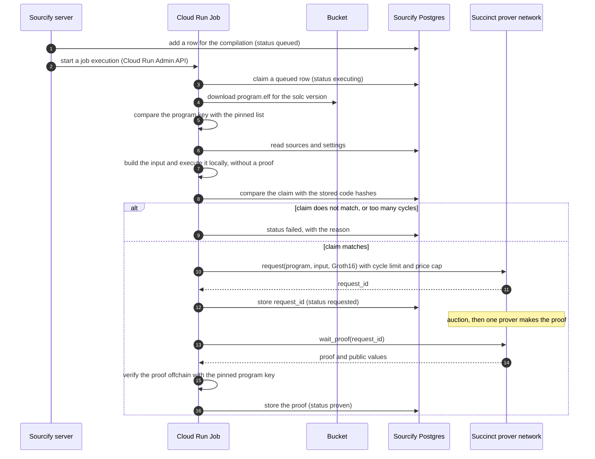

# GCP architecture

This is a plan. Nothing in it is built yet.

A Cloud Run Job makes proofs for compilations that are verified on Sourcify. The job does no proving work itself: the Succinct prover network makes the proofs. The job prepares the input, checks it, sends the request, waits, checks the proof and stores it.

| Part | What it does |
| --- | --- |
| Sourcify server | Adds a queued row for a compilation, then starts a job execution through the Cloud Run Admin API. |
| Cloud Run Job | Prepares the input, talks to the prover network, checks and stores the proofs. |
| Cloud Storage bucket | Holds `program.elf` and `build.json` for each solc build, at a path that contains the program key. |
| Sourcify Postgres | Holds the sources and settings, and a new table with one row per `(compilation_id, program_vkey)`. The table is also the work queue. |
| Secret Manager | Holds `NETWORK_PRIVATE_KEY`. The prover network takes its fee in PROVE from this account. |
| Succinct prover network | Runs an auction. The prover that wins makes the Groth16 proof. |

## Flow

## Notes

- **The job takes queued rows, not one compilation ID.** So it also picks up rows that earlier runs left behind, for example after an auction timeout. Two executions at the same time take different rows (`SELECT … FOR UPDATE SKIP LOCKED`).
- **Local execution is free.** It gives the cycle count and the claim. The job pays only after the claim matches the code hashes in the database.
- **The request is the step that costs money.** The job stores `request_id` before it waits. After a crash, the next run finds the row with status `requested` and calls `wait_proof` on the stored ID. It never sends a second request for the same compilation.
- **Two limits cap the cost.** `cycle_limit` comes from the local execution. `max_price_per_pgu` is the highest price per unit of prover gas. If no prover accepts the price, the request fails after the auction timeout and the row goes back to `queued`.
- **The bucket needs no trust.** The job computes the program key of the downloaded ELF and stops if it is not in the pinned list.
- **Cloud Run retries stay at 0.** The rows in the database control retries.
